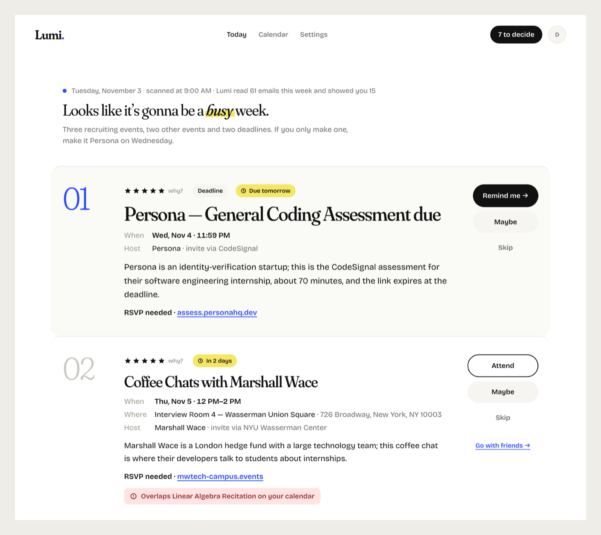
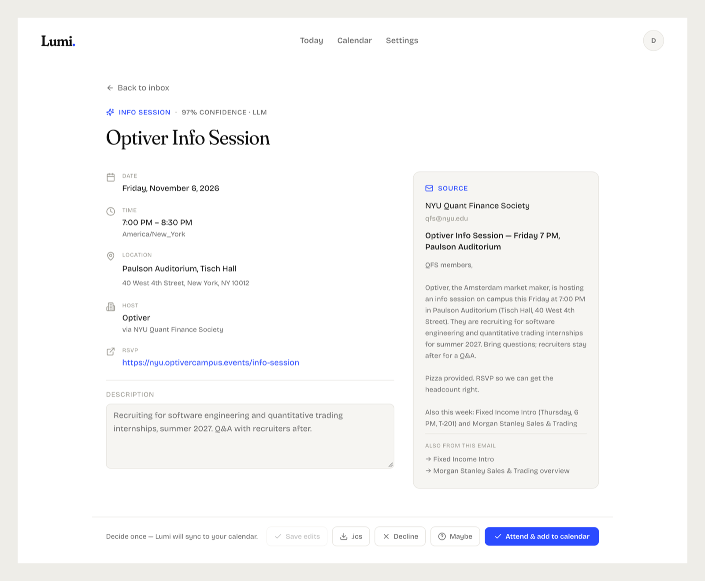
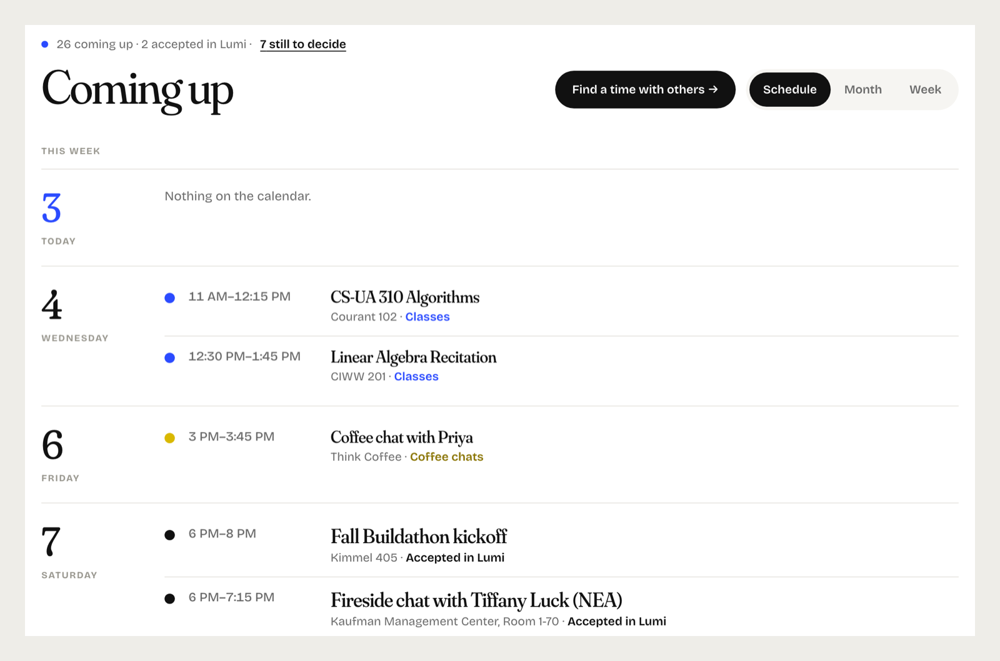
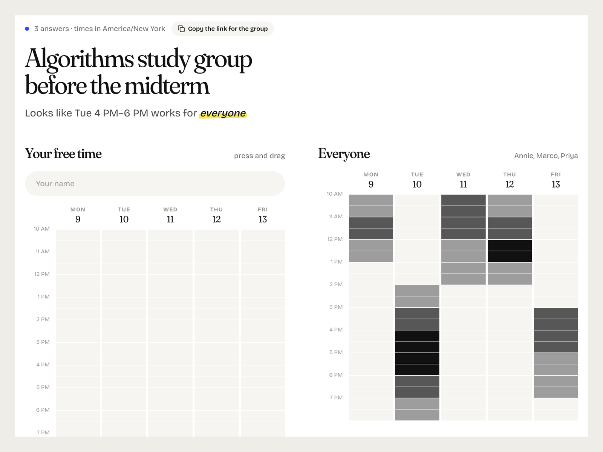
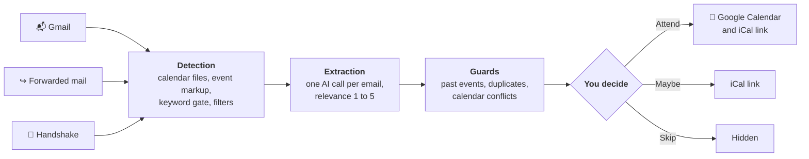

# Lumi

### Every invite, sorted.

Lumi reads the newsletters and announcements in your inbox, finds the events
buried inside them, ranks them by how well they fit you, and asks one
question per event: ***attending?*** Yes puts it on your Google Calendar.
Nothing lands there until you say so.

**[Try the live demo →](https://lumi-demo.fly.dev)**
&nbsp;&nbsp;·&nbsp;&nbsp;[See it work](#a-quick-tour)
&nbsp;&nbsp;·&nbsp;&nbsp;[How it works](#how-it-works)
&nbsp;&nbsp;·&nbsp;&nbsp;[Privacy](#privacy)
&nbsp;&nbsp;·&nbsp;&nbsp;[For developers](docs/DEVELOPMENT.md)

 

The Today view, on the demo's sample inbox. The demo needs no sign-in and saves nothing.

 

## The problem

Students get a steady stream of event mail: info sessions, coffee chats,
application deadlines, club meetings, talks. Most of it arrives inside long
newsletters, a few useful lines in a wall of text.

<table>
<tr>
<th width="50%">What arrives</th>
<th width="50%">What Lumi shows</th>
</tr>
<tr>
<td valign="top">

> *Share your post-grad plans by completing the survey…
> Changemaker Fellowship 2026, deadline April 24th…
> Career Communities help you explore career paths…
> **Coffee Chats with Marshall Wace,** Apr 28, 12:00–2:00 PM,
> Interview Room 4…
> **Weil, Gotshal & Manges: An Intro to Careers in Big Law,**
> April 28th, 5:00–6:00 PM…
> AlphaSights is hiring… Teach for America…*

One email. Three events, five things that are not events.

</td>
<td valign="top">

| Fit | Event | When |
|---|---|---|
| ★★★★★ | Coffee Chats with Marshall Wace | Apr 28, 12–2 PM |
| ★★★☆☆ | Changemaker Fellowship application | Due Apr 24 |
| ★★☆☆☆ | Intro to Careers in Big Law | Apr 28, 5–6 PM |

Ranked for a student looking for tech internships, each with **Attend**, **Maybe** or **Skip**. The survey, the job ads and the
program blurbs are filtered out.

</td>
</tr>
</table>

Email clients already recognize flights and restaurant bookings. They do not
read a club digest, pull out the events in it, and tell you which ones are
worth your evening. Lumi does, and leaves the decision with you.

## A quick tour

### Every event shows where it came from

Open any card to see the email it was found in, next to what Lumi extracted.
Other events from the same email are one click away. Fix a detail if Lumi got
it wrong, then **Attend & add to calendar**.

 

### Your week at a glance

Your own Google Calendar and the events you accepted in Lumi, in one list.
Undecided events stay on Today until you choose.

 

### Find a time together

Share a poll link. Friends mark when they are free without making an
account, and Lumi ranks the times that work for everyone.

 

### Three ways to bring mail in

| Source | How it works | Permission needed |
|---|---|---|
| 📬 **Gmail** | Checks your inbox twice a day for new mail. Promotions, Social, archived and sent mail are never read. | Optional Gmail and Calendar access, granted separately after sign-in |
| ↪️ **Forward to Lumi** | A private forwarding address. Forward a newsletter, or set a filter to forward them automatically. | None |
| 🤝 **Handshake** | Your personal Handshake calendar link, refreshed on every check. | None |

Every event you accept is also in a private iCal link, for Apple Calendar,
Outlook and others.

## How it works

1. **Detection.** Exact signals first: calendar attachments and structured
   event markup. A keyword gate and rule-based filters then drop surveys,
   receipts, duplicates and mail with no date before any AI model is called.
2. **Extraction.** One model call per remaining email finds every event in
   it and scores each one from 1 to 5 against your interests.
3. **Guards.** Past events are dropped, the same event from two senders is
   merged, and overlaps with your calendar are flagged.
4. **Decision.** Attend writes the event to Google Calendar. Changing your
   mind removes it.

More in [docs/ARCHITECTURE.md](docs/ARCHITECTURE.md) and
[docs/handshake.md](docs/handshake.md).

## Privacy

- ✋ **You decide every time.** Lumi never adds, accepts or declines anything
  on its own.
- 🔑 **Minimal access.** Sign-in asks for your name and email only. Inbox and
  calendar access are optional, and forwarding works without either.
- 📥 **Limited reading.** Only your primary inbox, and only mail newer than
  the last check.
- 🗑️ **Short retention.** Email content is deleted after 14 days.

## Built with

Next.js 15 · React 19 · Tailwind · Prisma on PostgreSQL · NextAuth with
Google · Gmail and Google Calendar APIs · Claude, or any OpenAI-compatible
model · Vitest. Type set in Fraunces and Bricolage Grotesque.

## For developers

Setup, run modes, environment variables, the API, tests and deployment are
in **[docs/DEVELOPMENT.md](docs/DEVELOPMENT.md)**.

## License

MIT, see [LICENSE](LICENSE).
