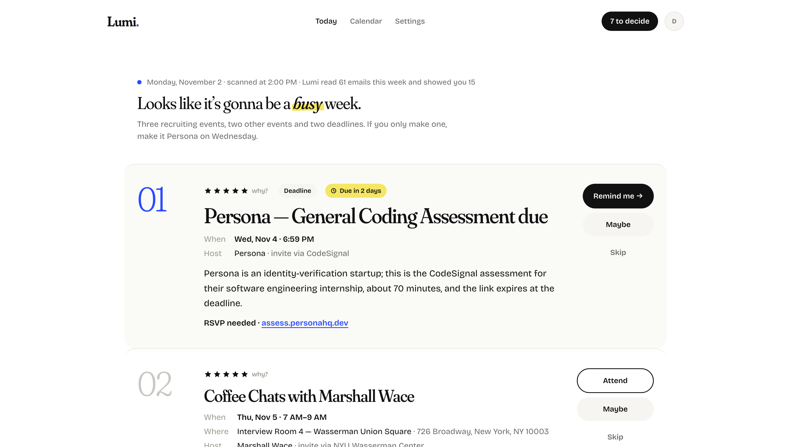

# Lumi

**Every invite, sorted.** Lumi reads the newsletters and announcements in your
inbox, finds the events buried inside them, ranks them by how well they fit
you, and asks one question per event: *attending?* Yes puts it on your Google
Calendar. Nothing lands there until you say so.




**[Try the live demo →](https://lumi-demo.fly.dev)** No sign-in needed. The
demo runs on a sample inbox, and nothing you do there is saved.

## Why Lumi

Students and early-career professionals get a steady stream of event mail:
info sessions, coffee chats, application deadlines, club meetings, talks.
Most of it arrives inside long newsletters and digests, a few useful lines in
a wall of text. The result is either hours spent reading and copying dates by
hand, or missed opportunities.

Email clients already recognize flights and restaurant bookings. They do not
read a club digest, pull out the ten events in it, and tell you which two are
worth your evening. Lumi does exactly that, and leaves the decision with you.

## Features

**Today.** A one-line read on your week, then every event still waiting for a
decision, most relevant first. Each card says where it came from and why it
was ranked where it is, with the paragraph of the email it was found in.
Attend, Maybe or Skip, with keyboard shortcuts for all three.

**Calendar.** The coming weeks at a glance, with what is confirmed on your
Google Calendar and what is still undecided.

**Find a time together.** Share a poll link; friends mark when they are free
without creating an account. Lumi ranks the slots everyone shares, and the
time you pick goes on your calendar.

**Three ways to bring mail in.**

| Source | How it works | Permission needed |
|---|---|---|
| Gmail | Lumi checks your inbox twice a day for new mail. Promotions, Social, archived and sent mail are never read. | Optional Gmail and Calendar access, granted separately after sign-in |
| Forward to Lumi | A private forwarding address. Forward a newsletter, or set a filter to forward them automatically. | None |
| Handshake | Your personal Handshake calendar link, refreshed on every check | None |

**Apple Calendar and others.** A private iCal subscription link for every
event you accept.

## How it works

```
Email → Detection → Extraction + relevance → Conflict check → Card → You decide → Calendar
```

1. **Ingestion.** Gmail, forwarded mail and the Handshake feed enter one pipeline.
2. **Detection.** Exact signals first: calendar attachments and structured
   event markup. A keyword gate and rule-based filters then drop surveys,
   receipts, duplicates and mail with no date before any AI model is called.
3. **Extraction.** One model call per remaining email finds every event in it
   and scores each one from 1 to 5 against your interest profile.
4. **Guards.** Past events are dropped, the same event from two senders is
   merged, and overlaps with your calendar are flagged.
5. **Decision.** Attend writes the event to Google Calendar. Changing your
   mind removes it.

Details are in [docs/ARCHITECTURE.md](docs/ARCHITECTURE.md), and the
Handshake source in [docs/handshake.md](docs/handshake.md).

## Privacy

- **You decide every time.** Lumi never adds, accepts or declines anything on
  its own.
- **Minimal access.** Sign-in asks for your name and email only. Inbox and
  calendar access are optional, and forwarding works without either.
- **Limited reading.** Only your primary inbox, and only mail newer than the
  last check.
- **Short retention.** Email content is deleted after 14 days.

## Try it

**[lumi-demo.fly.dev](https://lumi-demo.fly.dev)** opens Lumi on a sample
inbox. There is nothing to install and no account to create. Choose an event,
answer *attending?*, and see where it goes. A sample group poll is at
[/meet/demo-study-group](https://lumi-demo.fly.dev/meet/demo-study-group).
Nothing you do in the demo is saved.

## For developers

Setup, the three run modes, tests and the evaluation scripts are in
[docs/DEVELOPMENT.md](docs/DEVELOPMENT.md).

## Deploying

Lumi runs as a single web service plus Postgres. Inbox checks are triggered
by any scheduler calling `POST /api/cron/sweep` with the `CRON_SECRET`
bearer token, so no background worker or queue is required, and the web
machine can stop when idle.

- **Fly.io.** `fly.live.toml` is a production config (Google sign-in,
  Postgres, scheduled checks). `fly.demo.toml` serves the sample inbox with no
  database and no sign-in. Never point a demo deployment at real mail: it has
  no sign-in, so anything in its database is public.
- **Single server with Docker.** See [DEPLOY.md](DEPLOY.md), which also covers
  the Google OAuth setup every deployment needs.

## Environment variables

All keys live in `.env.example`.

| Variable | Needed for | Notes |
|---|---|---|
| `DATABASE_URL` | Persisted, live | Defaults to the Docker Compose Postgres |
| `NEXTAUTH_URL`, `NEXTAUTH_SECRET` | Auth | The app's public address; `openssl rand -base64 32` |
| `GOOGLE_CLIENT_ID`, `GOOGLE_CLIENT_SECRET` | Live | OAuth app published to production; sign-in uses non-sensitive scopes, Gmail read-only and Calendar events are requested on connect |
| `ANTHROPIC_API_KEY` | Extraction | Or `LLM_API_KEY` + `LLM_BASE_URL` for Qwen and any OpenAI-compatible endpoint |
| `LLM_MODEL` | Extraction | Default `claude-haiku-4-5`; `claude*` routes to Anthropic, anything else to the compatible endpoint |
| `LLM_COMPACT_LINKS` | Extraction | `true` (default) swaps URLs for placeholders before the model call |
| `PREFILTER_SENDER_HISTORY` | Detection | `true` (default) mutes bulk senders that never produce events |
| `INGEST_MODE` | Sweeps | `inline` (default, no Redis) or `queue` (BullMQ, needs `REDIS_URL`) |
| `INGEST_GMAIL_FILTER` | Gmail | Gmail search terms bounding what Lumi may read; default inbox only |
| `INGEST_SWEEP_TIMES`, `INGEST_SWEEP_TZ` | Worker | Default `13:00,19:00` in `America/New_York`; empty disables |
| `CRON_SECRET` | External sweeps | Enables `POST /api/cron/sweep`; unset returns 503 |
| `INBOUND_EMAIL_DOMAIN` | Forwarding | Domain of the `lumi+<token>@` addresses, MX pointed at Postmark; empty hides the feature |
| `INBOUND_WEBHOOK_SECRET` | Forwarding | Shared secret Postmark presents on `POST /api/ingest/inbound` |
| `HANDSHAKE_ICS_URL` | Handshake | Single-user fallback; the per-user link is set in Settings |
| `GMAIL_PUBSUB_TOPIC`, `GMAIL_WEBHOOK_SECRET` | Gmail push | Optional; present in the code, not activated |
| `CALENDAR_FEED_TOKEN`, `CALENDAR_FEED_EMAIL` | Legacy feed | Only for subscriptions made before per-user feed links |
| `LUMI_DEMO_USER_EMAIL` | Demo | Which account demo mode shows when the database has several |
| `LUMI_USE_MOCK_FALLBACK` | Demo | `true` (default) serves sample data when there is no database |
| `LUMI_DEMO_URL` | Landing page | Origin of a separate demo deployment; the demo links go there. Unset keeps them on this host |

## API

| Route | Purpose |
|---|---|
| `GET /api/events` | Events, optional `?status=PENDING` |
| `GET/PATCH /api/events/[id]` | One event; PATCH changes status and drives calendar sync |
| `GET /api/events/[id]/ics` | One event as `.ics` |
| `POST/DELETE /api/events/[id]/sync` | Write to or remove from Google Calendar |
| `GET /api/emails/[id]` | The email an event came from |
| `GET /api/calendar.ics?token=…` | Per-user iCal feed of accepted and maybe events |
| `GET/POST /api/calendar-feed` | Mint or rotate the signed-in user's feed link |
| `POST /api/meet`, `GET /api/meet` | Create a poll; list yours |
| `GET /api/meet/[slug]` | Poll, every answer, ranked common times |
| `PUT /api/meet/[slug]/respond` | Save one person's free slots, no account |
| `POST /api/meet/[slug]/final` | Owner picks the time; synced to their calendar |
| `GET /api/meet/[slug]/final.ics` | The picked time as `.ics`, for everyone else |
| `GET/PUT /api/profile` | Interest profile and onboarding flag |
| `GET /api/metrics` | Signed-in user's funnel, `?days=7` |
| `GET/POST /api/miss` | "Lumi missed something" reports |
| `GET /api/sync/status` | Last scan and database connectivity |
| `POST /api/ingest/poll` | Scan now: Gmail plus Handshake |
| `POST /api/ingest/inbound` | Postmark inbound webhook for forwarded mail |
| `GET/POST /api/sources/forwarding` | The user's forwarding address; POST rotates it |
| `GET/PUT/DELETE /api/sources/handshake` | Connect or disconnect the Handshake feed |
| `POST /api/cron/sweep` | Run a sweep, bearer `CRON_SECRET` |

## Project structure

```
prisma/schema.prisma      database schema
src/app/                  landing page and public poll pages
src/app/(signed-in)/      dashboard, calendar, events, onboarding, settings, behind the session check
src/app/api/              routes listed above
src/components/           Landing, EventFeed, EventCard, MeetGrid, StarCursor, Nav, ProfileEditor, MetricsCard
src/lib/brief.ts          the "Looks like…" headline and per-event fallback sentence
src/lib/meet.ts           poll grid, slot keys, best-time ranking
src/lib/meetStore.ts      Prisma or in-memory poll storage
src/lib/detection/        ics, schema.org, keyword gate, pre-filter
src/lib/services/         gmail, inbound, ingest, detect, extract, calendar, sweep, handshake
src/lib/                  auth, apiAuth, dataSource, feedToken, forwardingToken, metrics, retry, profile
scripts/                  seed, weekly metrics, golden-set snapshot, extractor A/B, pre-filter replay
docs/                     architecture, cost, metrics, handshake, the single-file demo
```

## Tech

Next.js 15, React 19, Tailwind, Prisma on PostgreSQL, NextAuth with Google,
Gmail and Google Calendar APIs, Claude (or any OpenAI-compatible model) via
forced tool use, Vitest. Fraunces and Bricolage Grotesque for the type.

## License

MIT, see [LICENSE](LICENSE).
