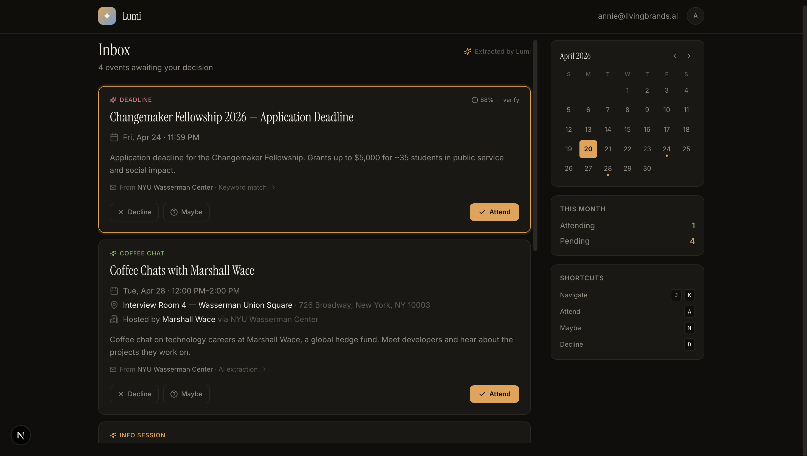

# 📬 Lumi

**AI-powered email-to-calendar assistant.** Lumi scans your inbox, detects event invitations, extracts structured details, ranks them by how relevant they are to you, flags calendar conflicts, and adds the ones you accept to Google Calendar with one click.

**Status:** the hosted demo and live instance were shut down on 2026-10-02 for
cost. Demo mode still runs locally with no credentials (`npm install && npm run dev`).

**Docs:** [architecture](docs/ARCHITECTURE.md) · [cost](docs/COST.md) · [metrics](docs/METRICS.md) · [Handshake source](docs/handshake.md)




---

## How It Works

```
Email arrives → Detection → LLM Extraction + Relevance scoring → Conflict check → Ranked Event Card → User decides → Calendar sync
```

0. **Sources** — Gmail, a private forwarding address (`lumi+<token>@…`, for users who grant no Gmail access; mail arrives through a Postmark inbound webhook), plus the user's Handshake iCal export feed (Handshake has no student-facing API; see [docs/handshake.md](docs/handshake.md))
1. **Ingestion** — a worker sweeps Gmail twice a day (1 PM and 7 PM local, configurable via `INGEST_SWEEP_TIMES`), incrementally (only mail newer than what's already ingested, hard-capped to a rolling 14-day window). Every ingest path is bounded by `INGEST_GMAIL_FILTER` — inbox only, no Promotions/Social/Updates/Forums, no archived or sent mail
2. **Detection** — Tiered classifier: ICS attachments → schema.org markup → keyword gate + rule-based pre-filter → LLM. The pre-filter skips surveys, mail with no date or time, duplicate content, replies that add nothing, and bulk senders with no track record, before any model call. Past events are dropped; the same event announced by two senders is fuzzy-deduped (start-time window + title overlap)
3. **Extraction + Ranking** — Claude `tool_use` extracts structured event JSON and, in the same call, scores relevance 1–5★ against the user's interest profile (tech/SWE/product/cloud/AI/hackathons high, networking mid, unrelated low)
4. **Calendar awareness** — each new event is checked against the user's Google Calendar; overlaps get an "Overlaps with X" badge (informational only — the decision stays with the user), refreshed every sweep
5. **Dashboard** — light-themed card UI sorted by relevance stars, with Attend / Maybe / Decline actions (keyboard: `a`/`m`/`d`). Decided cards leave the interface; data older than 14 days is purged automatically
6. **Calendar** — Attend writes the event to Google Calendar; walking a decision back removes it

## Architecture

See [docs/ARCHITECTURE.md](docs/ARCHITECTURE.md) for the pipeline diagram, the
stage-by-stage file map, the data model and failure handling.

## Tech Stack

| Layer         | Technology                                       |
|---------------|--------------------------------------------------|
| Frontend      | Next.js 15, React 19, Tailwind CSS, Framer Motion |
| Backend       | Next.js API routes; sweeps run inline (BullMQ + Redis optional via `INGEST_MODE=queue`) |
| Database      | PostgreSQL 16 + Prisma ORM                       |
| Email         | Gmail API, polled on a schedule (read-only scope) |
| Handshake     | Personal iCal export feed (no student API exists) |
| Calendar      | Google Calendar API                              |
| LLM           | Claude or Qwen via forced tool use (`LLM_MODEL`) |
| Auth          | NextAuth.js (Google OAuth)                       |
| Validation    | Zod                                              |

## Deployments

Nothing is deployed at the moment. `fly.toml` is the credential-free demo;
`fly.live.toml` is a web-only live instance whose sweeps are triggered by
`.github/workflows/sweep.yml`. Costs and options: [docs/COST.md](docs/COST.md).

## Getting Started

### Prerequisites

- Node.js 20+
- Docker (for local Postgres + Redis) OR your own hosted services
- Google Cloud project with Gmail + Calendar APIs enabled (optional — demo mode works without)
- Anthropic API key (optional — demo mode works without)

### Three modes

Lumi runs in three modes depending on which credentials you've provided:

| Mode           | DB / Redis | Google OAuth | Anthropic | What works                                          |
|----------------|------------|--------------|-----------|-----------------------------------------------------|
| **Demo**       | —          | —            | —         | Full UI against mock data (default, no setup)       |
| **Persisted**  | ✓          | —            | —         | UI writes to real DB; sample data via seed          |
| **Live**       | ✓          | ✓            | ✓         | Gmail ingestion + Claude extraction + Calendar sync |

### 1. Clone & install

```bash
git clone https://github.com/anniehyd/Lumi.git
cd Lumi
npm install
```

### 2. Configure environment

```bash
cp .env.example .env
```

For demo mode, no edits needed. For persisted/live, fill in the relevant keys
(see [Environment Variables](#environment-variables)).

### 3. Start infra (persisted + live modes)

```bash
docker compose up -d        # Postgres on 5432 (and Redis on 6379, only needed for INGEST_MODE=queue)
npx prisma migrate dev --name init
npm run db:seed             # loads the NYU Wasserman newsletter demo
```

### 4. Run the app

```bash
npm run dev
```

Open [http://localhost:3000](http://localhost:3000). In demo mode the inbox
populates immediately from mock data; in live mode it populates after the first
Gmail scan.

### 5. Run sweeps (live mode)

```bash
npm run worker
```

Sweeps every connected inbox at the times in `INGEST_SWEEP_TIMES`. In the
default inline mode this is a timer and needs no Redis. Alternatively skip the
worker and call `POST /api/cron/sweep` from any scheduler.

### Tests

```bash
npm run test:run        # 200+ tests, all on mocks and fixtures — no network
npm run eval:prefilter  # replay eval/golden through the pre-filter (needs your own snapshot)
```

## Environment Variables

All keys live in `.env.example`. Summary:

| Variable                 | Required for | Notes                                                       |
|--------------------------|--------------|-------------------------------------------------------------|
| `DATABASE_URL`           | Persisted    | Defaults to the Docker Compose Postgres                     |
| `INGEST_MODE`            | —            | `inline` (default, no Redis) or `queue` (BullMQ)            |
| `REDIS_URL`              | Queue mode   | Only read when `INGEST_MODE=queue`                          |
| `NEXTAUTH_URL`           | Auth         | `http://localhost:3000` locally                             |
| `NEXTAUTH_SECRET`        | Auth         | `openssl rand -base64 32`                                   |
| `GOOGLE_CLIENT_ID/SECRET`| Auth + Gmail + Calendar | Google Cloud Console OAuth app                 |
| `ANTHROPIC_API_KEY`      | Extraction   | `console.anthropic.com`                                     |
| `LLM_MODEL`              | Extraction   | Default `claude-haiku-4-5`. `claude*` → Anthropic, else Qwen |
| `LLM_COMPACT_LINKS`      | Extraction   | `true` (default) replaces URLs with placeholders before the model call |
| `PREFILTER_SENDER_HISTORY` | Detection  | `true` (default) mutes bulk senders that never produce events |
| `LLM_API_KEY`            | Extraction   | Qwen / OpenAI-compatible key (not needed for Claude)        |
| `LLM_BASE_URL`           | —            | Default Alibaba Model Studio international endpoint          |
| `CRON_SECRET`            | —            | Enables `POST /api/cron/sweep`; unset = route returns 503    |
| `GMAIL_PUBSUB_TOPIC`     | Push ingest  | Optional — falls back to scheduled sweeps                   |
| `INGEST_GMAIL_FILTER`    | All ingest   | Gmail search terms bounding what Lumi may read; default is inbox-only, no Promotions/Social/Updates/Forums |
| `INGEST_SWEEP_TIMES`     | Worker       | Local `HH:MM` sweep times, default `13:00,19:00`; empty disables |
| `INGEST_SWEEP_TZ`        | Worker       | IANA zone for those times, default `America/New_York`       |
| `GMAIL_WEBHOOK_SECRET`   | Push ingest  | Shared secret Pub/Sub sends as `?token=…`                   |
| `INBOUND_EMAIL_DOMAIN`   | Forwarding   | Domain users forward mail to (`lumi+<token>@` this). MX → Postmark. Empty hides the feature |
| `INBOUND_WEBHOOK_SECRET` | Forwarding   | Shared secret Postmark presents as basic-auth password on `POST /api/ingest/inbound` |
| `HANDSHAKE_ICS_URL`      | Handshake    | Personal iCal export link (Handshake → Settings → Calendar export). Single-user fallback; per-user setting lives in the DB. See [docs/handshake.md](docs/handshake.md) |
| `LUMI_USE_MOCK_FALLBACK` | Demo         | `true` (default) falls back to mocks when DB unreachable    |

## API Surface

| Route                            | Purpose                                   |
|----------------------------------|-------------------------------------------|
| `GET  /api/events`               | List events (optional `?status=PENDING`)  |
| `GET/PATCH  /api/events/[id]`    | Single event; PATCH to change status      |
| `GET  /api/events/[id]/ics`      | Download single event as .ics             |
| `POST/DELETE  /api/events/[id]/sync` | Write/remove from Google Calendar     |
| `GET  /api/calendar.ics?token=…` | Per-user iCal feed (accepted + maybe)     |
| `GET/POST /api/calendar-feed`    | Mint / rotate the signed-in user's feed link |
| `POST /api/meet`                 | Create a group scheduling poll            |
| `GET  /api/meet/[slug]`          | Poll, every answer, ranked common times   |
| `PUT  /api/meet/[slug]/respond`  | Save one person's free slots (no account) |
| `POST /api/meet/[slug]/final`    | Owner picks the time; synced to Calendar  |
| `GET  /api/emails/[id]`          | Single email (source of an event)         |
| `GET  /api/sync/status`          | Ingest health + DB connectivity           |
| `GET  /api/metrics`              | Signed-in user's funnel (`?days=7`)       |
| `POST /api/cron/sweep`           | Run a sweep (bearer `CRON_SECRET`)        |
| `POST /api/ingest/poll`          | Manual Gmail + Handshake scan (authed user) |
| `GET/PUT/DELETE /api/sources/handshake` | Connect/disconnect the Handshake feed |
| `GET/POST /api/sources/forwarding` | The user's forwarding address (GET mints, POST rotates) |
| `POST /api/ingest/inbound`       | Postmark inbound webhook: one forwarded email in, same pipeline as Gmail |
| `POST /api/ingest/webhook`       | Gmail Pub/Sub push handler                |

## Project Structure

```
prisma/schema.prisma        database schema
src/app/                    pages (dashboard, calendar, events, onboarding, settings)
src/app/api/                routes: events, emails, ingest, cron/sweep, metrics, profile, miss, sources
src/components/             EventCard, EventFeed, MiniCalendar, MetricsCard, ProfileEditor, …
src/lib/detection/          ics, schema.org, keyword gate, pre-filter
src/lib/services/           gmail, ingest, detect, extract, calendar, sweep, scheduler, handshake
src/lib/                    auth, apiAuth, dataSource, metrics, retry, profile
scripts/                    seed, weekly metrics, golden-set snapshot, extractor A/B, pre-filter replay
docs/                       architecture, cost, metrics, handshake
```

## License

MIT — see [LICENSE](LICENSE).
