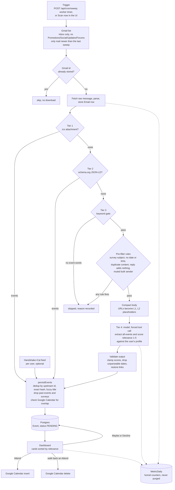

# Lumi architecture

How an email becomes a calendar entry, as the code stands on the
`overnight-improvements` branch. File references are the source of truth; if
this document and the code disagree, the code wins.

## One-paragraph version

Twice a day a sweep lists each connected user's new inbox mail, stores it, and
runs it through a tiered detector that tries free, exact methods first (an
attached `.ics`, schema.org markup) and only then considers a language model.
Before any model call a keyword gate and a rule-based pre-filter throw out mail
that cannot contain an event. The model extracts every event in the email and
scores each 1–5 for fit against the user's own interest profile. Events are
de-duplicated, checked against the user's Google Calendar for overlaps, and
shown as cards sorted by relevance. Accepting a card writes it to Google
Calendar. Nothing is auto-accepted and nothing is deleted for being irrelevant —
low scores sink, they don't disappear.

## Pipeline

## Stages and where they live

| Stage | File | What it does |
|---|---|---|
| Trigger | `src/app/api/cron/sweep/route.ts`, `src/lib/services/scheduler.ts`, `src/app/api/ingest/poll/route.ts` | Three ways in: an authenticated HTTP call from an external scheduler, the worker's wall-clock timer (default 13:00 and 19:00 New York), or the signed-in user pressing Scan. |
| Sweep | `src/lib/services/sweep.ts` | For each user with a Google account: build the incremental Gmail query, ingest, refresh conflict badges, then purge data older than 14 days. |
| Gmail | `src/lib/services/gmail.ts` | `MAIL_FILTER` is the single place that bounds what Lumi may read. Read-only scope. |
| Ingest | `src/lib/services/ingest.ts` | Skip known ids, download, store, run detection, record metrics. `retryUnprocessed` gives failed emails up to 3 attempts. |
| Detection | `src/lib/services/detect.ts` | `processEmail` runs the four tiers and the stateful skip rules. |
| Tier 1 | `src/lib/detection/ics.ts` | Parse VEVENTs. Confidence 1.0. |
| Tier 2 | `src/lib/detection/schema.ts` | Parse schema.org `Event` JSON-LD from the HTML part. Confidence 0.95. |
| Tier 3 | `src/lib/detection/keyword.ts`, `src/lib/detection/prefilter.ts` | 20 event phrases gate the model; then the free rules. |
| Tier 4 | `src/lib/services/extract.ts`, `src/lib/profile.ts` | One model call per email via forced tool use. Extraction and relevance scoring happen in the same call. |
| Persist | `src/lib/services/detect.ts` (`persistEvents`) | Shared by email and Handshake so both get identical guards. |
| Calendar | `src/lib/services/calendar.ts` | Overlap lookup, insert on Attend, delete on walk-back. |
| UI data | `src/lib/dataSource.ts`, `src/lib/apiAuth.ts` | Every query is scoped to the signed-in user; mocks only in demo mode. |
| Metrics | `src/lib/metrics.ts`, `src/app/api/metrics/route.ts` | See [METRICS.md](METRICS.md). |

## The four tiers, honestly

The tiers are ordered by cost and certainty, and each one runs only if the one
before found nothing.

1. **ICS** and 2. **schema.org** are exact parsers. They cost nothing and never
   guess.
3. **The keyword gate is a gate, not an extractor.** It answers "could this
   email contain an event?" and nothing else. Since tonight it is followed by
   the rule-based pre-filter (below).
4. **The model** does all the real extraction for ordinary mail.

In the one real sample in the repo (405 emails over 14 days, `eval/golden/`),
12 of 13 events came from tier 4, 1 from tier 1 and 0 from tier 2. So the
tiering is sound engineering, but today the model carries almost all of the
recall. That is worth saying plainly in an interview rather than implying the
parsers do most of the work.

### Pre-filter rules

All in `src/lib/detection/prefilter.ts`, applied in this order after the
keyword gate. Each has a recorded reason (`Email.skipReason`).

| Rule | Fires when | Needs state? |
|---|---|---|
| `survey` | The subject is a survey or review request | no |
| `no_temporal` | No date, weekday, or clock time anywhere in subject or body (URLs excluded) | no |
| `unchanged_thread` | A `Re:` whose earlier message is already stored and whose newly written text has no event words | yes |
| `duplicate` | Same sender + subject + normalized body already processed for this user | yes |
| `sender_history` | A bulk sender (has an unsubscribe header or footer) with 3+ model calls and zero events ever. Every 5th email is still sent as a probe. Never applied to mail from a person. | yes |

Gmail's own category labels do a first pass before any of this: the default
query excludes Promotions, Social, Updates and Forums.

### Relevance scoring

`src/lib/profile.ts` builds the user-specific half of the system prompt from
the onboarding answers (role, school, graduation year, interest chips, a free
text note). The 1–5 scale and its anchors are fixed across users so scores stay
comparable. The score is clamped and rounded on the way in
(`clampRelevance`), stored on `Event.relevance`, and used only for sorting.

Known gap: events from tiers 1 and 2 and from the Handshake feed never reach
the model, so they all get the neutral 3.

## Data model (`prisma/schema.prisma`)

| Table | Purpose | Retention |
|---|---|---|
| `User`, `Account`, `Session` | NextAuth; `Account` holds the Google refresh token. `User.profile` is the interest profile, `User.onboardedAt` gates onboarding, `User.calendarFeedToken` is the secret in that user's iCal subscription link. | permanent |
| `Email` | Stored message, with `processed`, `attempts`, `skipReason`, `contentHash`. Unique per `(userId, messageId)`. | 14 days |
| `Event` | Extracted event: status, relevance, conflict title, provenance (`detectedVia`, `extractedBy`, `promptVersion`). | 14 days after it passes or is decided |
| `SenderStat` | Per-sender model calls and events found, for the `sender_history` rule. | permanent, tiny |
| `LlmUsage` | One row per model call: tokens, cost, latency. | 14 days |
| `MetricDaily` | Funnel counters per user per UTC day. | permanent |
| `Miss` | User-reported "Lumi missed something" notes — the only recall signal. | permanent |

## Runtime topology

Two modes, chosen by `INGEST_MODE`:

- **`inline` (default).** The sweep ingests in the process that received the
  trigger. A deployment is one web machine that stops when idle, a Postgres
  database, and an external scheduler calling `POST /api/cron/sweep`. No Redis,
  no worker.
- **`queue`.** The sweep enqueues a BullMQ job per user; `npm run worker`
  consumes them. Needs Redis. This is how production ran until October, and
  what made it expensive ([COST.md](COST.md)).

`npm run worker` still works in inline mode: it is then just a timer that calls
the same sweep, useful for the single-box Docker deployment in `DEPLOY.md`.

## Failure handling

| Failure | What happens |
|---|---|
| Gmail / Calendar 429, 5xx, timeout | Retried up to 3 times with backoff and jitter (`src/lib/retry.ts`), honouring `Retry-After`. |
| Model API 429, 5xx, connection error | Retried by the Anthropic SDK (3 retries); the OpenAI-compatible path uses `withRetry`. |
| Detection throws after retries | The email stays `processed: false` and is retried on later sweeps, up to 3 attempts. |
| Google token refresh fails transiently | Retried; a real rejection (revoked grant) is logged as such. |
| Calendar insert times out mid-flight | The event id is chosen before the first attempt, so a retry gets 409 instead of creating a duplicate. |
| One user's ingest fails | Logged and reported to Sentry; the sweep continues with the next user. |
| Two sweeps triggered at once | The second joins the first. |
| Database connection dropped while idle | The sweep probes with `SELECT 1` and retries the probe before starting. |

## Things that are in the repo but not live

Worth knowing so you are not surprised in a code walkthrough:

- **Gmail push.** `startWatch` and `/api/ingest/webhook` exist but nothing
  calls `startWatch`, so no watch is ever registered. Ingestion is polling.
- **Maybe reminders.** `scheduleMaybeReminder` in `src/lib/queue.ts` is never
  called; no reminder is ever scheduled.
- **`User.timezone`** exists in the schema but nothing reads it; the model
  infers a timezone per event instead.
- **README project tree** described files that never existed; it is corrected
  on this branch.
